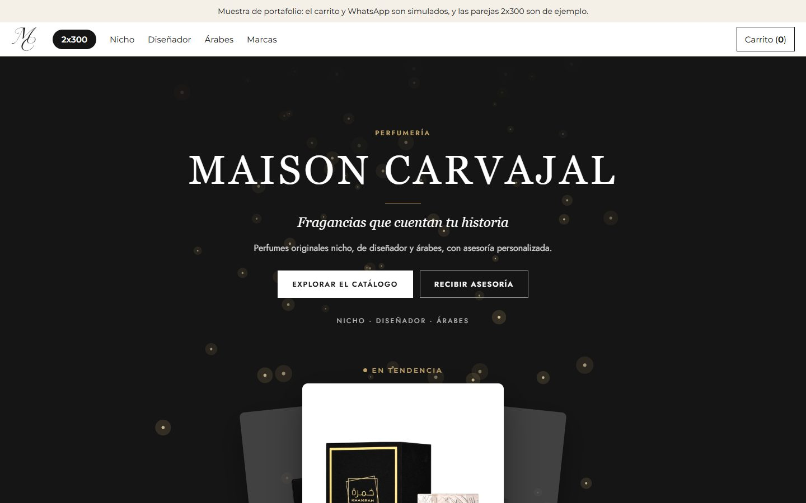
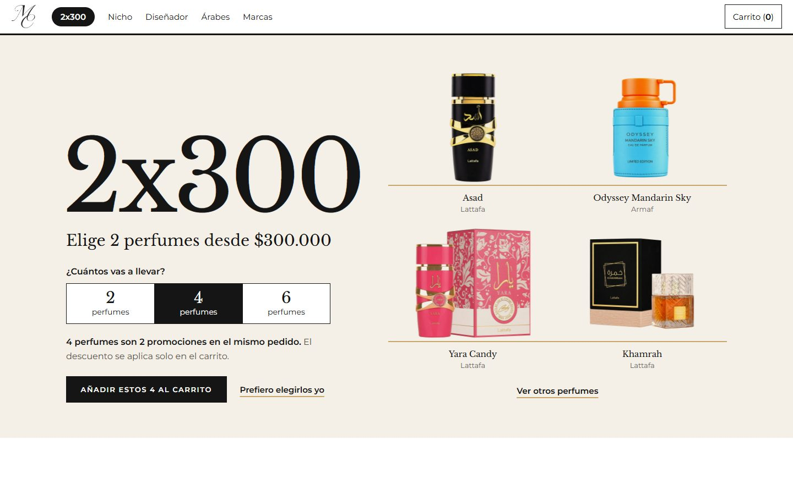
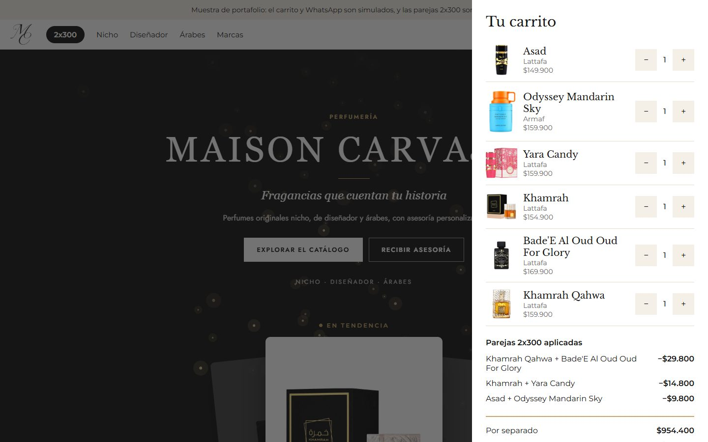
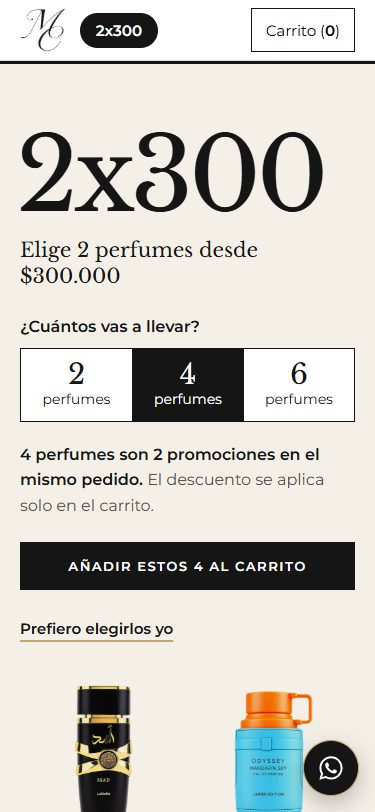
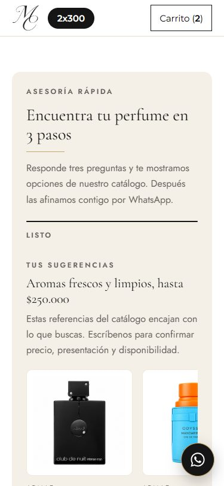

# Maison Carvajal · tienda en Shopify

Tienda en línea de mi perfumería en Barranquilla, Colombia. Es un proyecto personal en desarrollo; el tema todavía no se ha publicado.

### [Ver la muestra en línea →](https://acarvajalb21.github.io/maison-carvajal-web/)



## El problema

Vender 94 perfumes nicho, de diseñador y árabes a personas que muchas veces no saben cuál elegir, con una promoción que los temas de Shopify no traen: **dos perfumes compatibles por un precio fijo de $300.000, $350.000 o $400.000**.

Con varios perfumes en el carrito hay muchas formas de armar las parejas, y no todas ahorran lo mismo.

## Qué hice

**Promoción 2x300.** [`mc-2x300-auto.liquid`](shopify/snippets/mc-2x300-auto.liquid) lee el carrito y arma la combinación que más le ahorra al cliente:

1. Busca el emparejamiento de mayor ahorro. Es exacto hasta 14 unidades y usa una mejora por pasos en carritos mayores.
2. Pone los códigos de esas parejas, con un máximo de cinco por pedido.
3. Si el carrito descuenta menos de lo esperado, prueba otras combinaciones y conserva la más barata.
4. Quita los códigos que no se usaron y nunca toca los que escribió el cliente.

**Ayuda para elegir.** Un test de tres preguntas sugiere perfumes del catálogo y prepara un mensaje para WhatsApp. Las tendencias se exploran con pestañas, sin salir de la página.

**Modo de venta.** Cada perfume se compra en línea, se pide por WhatsApp o se consulta, según sus etiquetas.

**Identidad visual.** Inicio con partículas que se apartan del cursor y una vitrina que gira sola, con pausa, flechas, teclado y deslizamiento. Hay una alternativa sin animación para quien pide menos movimiento.

| Portada 2x300 | Carrito |
|---|---|
|  |  |

| Inicio | 2x300 | Test |
|---|---|---|
|  |  |  |

## Resultado

- En la tienda de prueba, todas las parejas de la promoción dieron el total exacto en el carrito de Shopify.
- El motor iguala a la mejor solución por fuerza bruta en 300 carritos simulados de 3 a 10 perfumes distintos.
- La muestra se revisó en escritorio y celular: sin errores de consola y sin desplazamiento horizontal.

El límite de cinco códigos puede impedir el ahorro máximo en carritos grandes con perfumes repetidos. Las pruebas de este repositorio no reemplazan las pruebas en Shopify.

## Qué es real y qué es de ejemplo

| Real | De ejemplo o simulado |
|---|---|
| Diseño, textos, catálogo, fotos y precios de venta de noviembre de 2026 | Parejas y códigos 2x300, armados solo con los precios de venta |
| Código de las secciones propias | Carrito y pago |
| Enlaces a Instagram | Botones de WhatsApp |

La base es el tema **Horizon** de Shopify, que no está incluido. Aquí solo están las partes a medida.

## Cómo está hecho

Liquid, Custom Elements, JavaScript y CSS sin frameworks. Node.js para armar la muestra y las pruebas, sin dependencias.

```
shopify/        secciones y snippets del tema
demo/           catálogo, carrito simulado y estilos de la muestra
herramientas/   scripts que arman la muestra y las parejas de ejemplo
docs/           muestra generada para GitHub Pages
pruebas/        pruebas del motor 2x300
capturas/       imágenes de este README
```

```bash
node herramientas/generar-2x300.mjs
node herramientas/construir-demo.mjs
node --test pruebas/*.mjs
```

## Derechos

El código y la marca no tienen licencia abierta: ver [DERECHOS.md](DERECHOS.md). El material de terceros está en [TERCEROS.md](TERCEROS.md).
